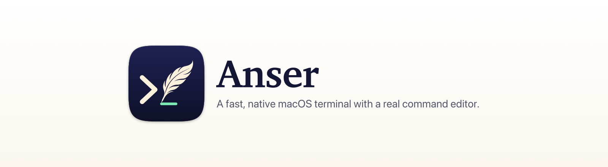

<p align="center">
  <picture>
    <source media="(prefers-color-scheme: dark)" srcset="branding/social/readme-banner-dark.png">
    
  </picture>
</p>

# Anser

A fast native macOS terminal built on **libghostty** (Ghostty's GPU terminal engine), with a real command editor on top.

## What it adds over a plain terminal

- **Command editor.** You type commands in a real macOS text field: select with the mouse or Shift/Option-arrows, type over a selection to replace it, drag to select, ⌘Z undo, Option-delete words. Enter runs the command. Shift/Option-Enter adds a new line.
- **Editor extras:**
  - Quotes and brackets close themselves, and typing one over a selection wraps it.
  - Double-click selects a whole path or flag; ⌥↑ / ⌥↓ grow or shrink the selection (word → command → line).
  - ⌥⌘F splits a long command into one pipe stage per line (or joins it back), and multi-line commands show line numbers.
  - ⇧⌘E gives a tall editor; ⌥⌘E opens the command in `$EDITOR` and brings it back when you quit.
  - A hint line explains the word under the cursor (`git commit -m ‹message›  Commit message`).
- **Autocomplete popup** as you type. Sources: history, commands on your PATH, aliases, functions, files and folders, plus git (branches, changed files, commits, stashes, remotes, tags), npm/yarn scripts, Make targets, SSH hosts, docker, brew, kubectl, gh and more. Commands without a spec get their flags from `--help` or the man page.
- **Ghost text.** Your best history match shows in gray. → accepts all of it, ⌥→ accepts one word.
- **History.** Every command is stored in SQLite with folder, exit code, duration and git branch. Your zsh/bash history is imported on first run. ↑/↓ steps through commands starting with what you've typed. ⌘R/⌃R opens fuzzy search, filtered by All, This folder, This tab or Failed.
- **Smart copy/paste.** ⇧⌘C copies the last command's output exactly. ⌥⌘C copies the last command. In the history list, ⌥⏎ copies any earlier command's output. ⇧⌘V opens clipboard history. Files pasted or dropped in become escaped paths. Multi-line pastes stay in the editor until you run them.
- **One input.** By default the shell's own waiting prompt is hidden, so the editor is the only place you type, and each command stays in the scrollback as `❯ command`. Settings → Shell prompt switches to a short `❯` or your own prompt. Turning the editor off (⌘E) always brings your prompt back.
- **Tabs** in Anser's own tab bar:
  - Double-click a tab (or press ⇧⌘I) to rename it; right-click for colors and close options.
  - Drag tabs to reorder them (the others slide aside), or press ⌥⌘← / ⌥⌘→. Middle-click closes one.
  - Right-click → Move Tab to New Window keeps its shells running.
  - ⌘1–9 jump to a tab, ⇧⌘[ / ⇧⌘] switch to the previous or next one.
- **Splits:** ⌘D splits right, ⇧⌘D splits down, ⌘[ / ⌘] move between panes.
- **Appearance** (⌘,): font, text sizes, 725 color themes, background opacity, cursor shape and padding. Changes apply live.
- **Programmable.** `~/.config/anser/config.json` holds abbreviations, snippets with `{{placeholders}}` you Tab between, keybindings (`run:`, `insert:`, `snippet:`, `action:`, `ghostty:`), and extra Ghostty settings. Custom completions go in `~/.config/anser/completions/*.json`, and they can run scripts to produce suggestions. The config reloads when you save it.
- **A status row you can click:**
  - The folder chip opens recent folders (⌘J); Enter `cd`s there.
  - The branch chip switches branches, or creates one when you type a new name (⇧⌘B).
  - "3 changed" lists changed files: diff, stage/unstage, open (⇧⌘G).
  - The result chip offers retry and copy actions.
- **Help when things fail:** typos like `gti status` get a one-click "Did you mean: git status"; any failed command offers "Edit & retry". A Stop button appears while a command runs.
- **Discoverable:** ⌘/ shows every shortcut, and a short welcome card appears on first launch (Help → Show Welcome Tips brings it back).
- **Command blocks:** a colored bar beside each command and its output (green ok, red failed, yellow running). Hover a block for its exit code, duration, Copy output, Copy command and Re-run.
- **⌘-click file paths** in output (`src/app.swift:42:10`, `main.go(7)`, Python tracebacks) to open them at that line in Cursor, VS Code, Zed or Sublime. Set `"openFilesWith"` in config to choose, including terminal editors like nvim.
- **Tabs show activity:** a spinner while a command runs, a red dot when one failed in the background, a blue dot when one finished. Narrow tabs get a ⌄ menu listing them all.
- **Previews in pickers:** diffs in Changed Files, output in Commands-in-this-tab, commit log plus ahead/behind in the branch switcher, folder contents in Jump to Folder.
- **Splits:** each pane gets a header (title, folder, zoom, close), the inactive pane is dimmed, and ⇧⌘↩ zooms a pane to full size and back.
- **Completion docs:** the full description of the highlighted suggestion appears beside the popup.
- **Sidebar** (⌃⌘S): git changes, recent folders and snippets, one click each.
- **Polish:** a ligatures on/off setting, recent actions first in the palette, VoiceOver labels throughout, and a status row that folds its buttons into "…" when narrow.
- **ssh:** `ssh host` from Anser brings the editor, completion and history into the remote zsh or bash. Hooks are unpacked into a temp folder for that session and deleted on logout; nothing is installed on the server. Completion skips your Mac's files while remote, and history entries are tagged `ssh://host/path`.
- **Workflows** (⌥⌘R): saved multi-step commands with `{{parameters}}`, with dropdowns where you list options. Personal ones live in `~/.config/anser/workflows/`; put them in a repo's `.anser/workflows/` to share with your team. Shell → Save Commands as Workflow… creates one from this tab.
- **Export** a tab's commands and outputs as Markdown (⇧⌘S, or Copy Tab as Markdown).
- **AI help (off by default):** "Explain" on a failed command, and Ask Claude for a Command (⌘I). It uses the Claude API (`claude-opus-5-5`, with Anthropic's server-side fallback on refusals) and your own API key, stored in the Keychain. Nothing is sent until you click, secrets are removed from output first, and suggested commands are only inserted, never run.
- **Collapse a block's output** from its hover strip; the output is covered with a placeholder (the space stays, since the terminal engine can't remove rows).
- **Problem reports:** crashes, UI hangs and recent activity are logged locally in `~/Library/Logs/Anser`. Help → Report a Problem builds a report you review and copy; nothing is uploaded.
- **Find** in scrollback with ⌘F, using Ghostty's own search.
- **Commands in this tab** (⌘B): every command you ran, with exit status and duration. Jump to it, copy its output, or run it again. ⌘↑/⌘↓ jumps between prompts.
- **Safe by default:**
  - Anser asks before closing a pane, tab or the app while something is running.
  - Commands that look like they contain secrets (`*token=*`, `export *secret*` and similar) are never saved to history.
  - You can pause history per tab.
  - Flags for unknown commands are read from man pages; only well-known tools are ever run with `--help`.
- **Session restore:** windows, tabs, splits and their folders come back on relaunch.
- **Full-screen programs** (vim, less, htop, tmux…) get the whole window; the bar comes back at the prompt.
- **Optional compact prompt** (`"compactPrompt": true`), since the bar already shows folder and branch.
- **Settings window** (⌘,) for the common options. Everything else lives in the config file.
- Your existing `~/.config/ghostty/config` (theme, font) is used automatically.

## More completions (optional)

Anser can lazily load the 700+ open-source [Fig autocomplete specs](https://github.com/withfig/autocomplete). Converting them runs the package's JavaScript, so it's a step you run yourself:

```sh
mkdir -p .build/fig && (cd .build/fig && npm pack @withfig/autocomplete && tar xzf withfig-autocomplete-*.tgz)
node scripts/import-fig-specs.mjs .build/fig/package Sources/AnserCore/Specs/fig
bash scripts/build-app.sh
```

Hand-written specs (git, common tools) still take priority over imported ones.

## Release

`bash scripts/release.sh` builds a release app and a DMG. To share with other Macs, set `SIGN_IDENTITY` (Developer ID) and `NOTARY_PROFILE` (from `xcrun notarytool store-credentials`).

## Build

```sh
bash scripts/build-ghostty.sh   # once: builds libghostty from upstream + patches/ (needs ~5 GB, a few minutes)
bash scripts/build-app.sh       # builds build/Anser.app
open build/Anser.app
```

Tests: `swift test` (51 unit tests; release benchmarks: `swift test -c release --filter PerformanceTests`). Live end-to-end check (104 checks that drive the real app, plus UI snapshots in `build/selftest/`): `bash scripts/selftest.sh`

## How it works

- `Sources/AnserCore`: pure Swift (lexer, fuzzy matcher, SQLite history, completion engine, specs, config). Unit tested.
- `Sources/Anser`: the AppKit app (Ghostty surface view, command editor, popup, panes, splits, pickers).
- `Resources/shell`: zsh/bash hooks. They send prompt and command events to the app through a private FIFO, using only shell builtins. They also load Ghostty's own integration, which provides the prompt marks.
- `patches/ghostty-anser.patch`: two small additions to libghostty, `ghostty_surface_read_command_output` (exact output copying) and `ghostty_surface_prompt_marks` (command block positions).

Shell support: zsh and bash get the full editor, in emacs or vi mode, locally and over ssh. fish has hooks too (not yet tested). Other shells (fish, nushell) still work as a normal Ghostty terminal; the bar says integration isn't active.
